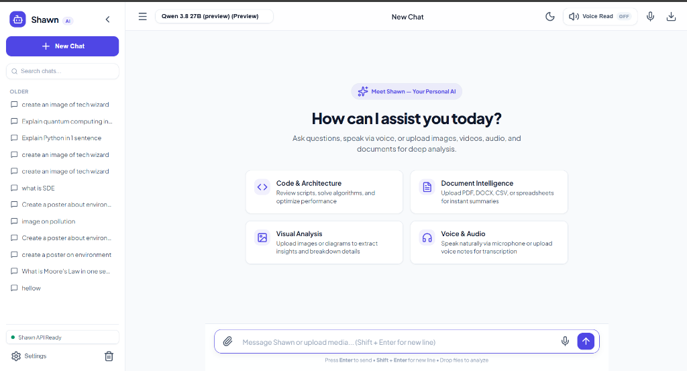
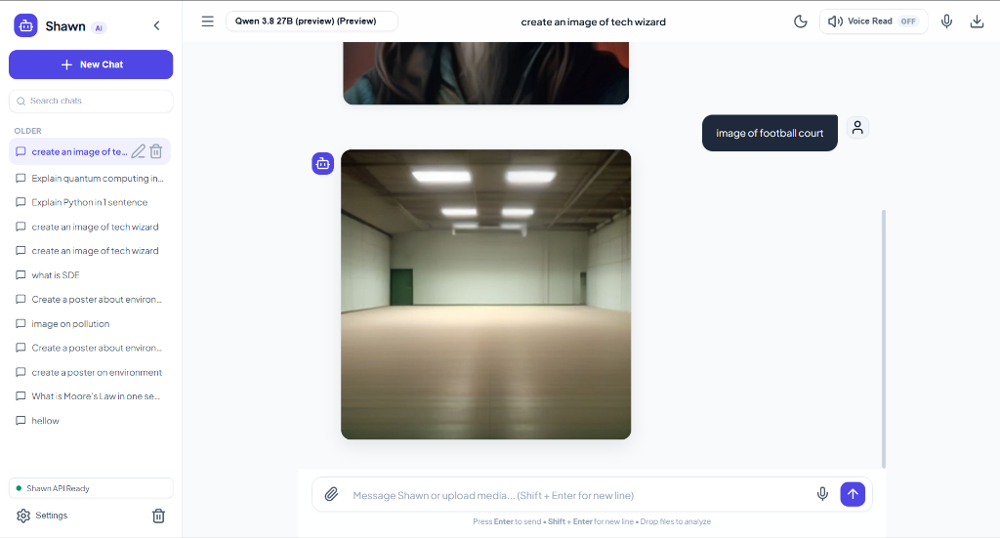

# Groq AI Chatbot

A browser-based AI chatbot powered by the Groq inference API, with multi-turn conversation history, file/document analysis, voice transcription, and on-demand image generation.

---

## Features

- **Streaming chat** — Server-Sent Events (SSE) deliver token-by-token responses for a real-time feel.
- **Multiple Groq models** — Switch between Qwen 3.8 27B, Groq Compound, Groq Compound Mini, GPT OSS 120B, GPT OSS 20B, and Allam 2 7B; automatic rate-limit fallback picks the next available model.
- **Intent routing** — The app classifies each user message as TEXT, IMAGE, or BOTH and handles each path independently (parallel text + image generation for BOTH).
- **File attachments** — Upload PDFs (text extracted up to 50 pages), DOCX/DOC (paragraphs + tables), XLSX/XLS (up to 5 sheets, 150 rows each), CSV/TSV, plain text, Markdown, code files (30+ extensions), and images. Files are saved to `uploads/` and the extracted content is injected into the Groq prompt.
- **Image generation** — Prompt the model to generate an image; the app calls Pollinations AI (free, default), OpenAI DALL-E 3, or Stability AI Core and stores results in `generated_images/`.
- **Voice transcription** — Record audio in the browser; the `.webm` recording is sent to Groq Whisper (`whisper-large-v3-turbo`) and the transcript is pasted into the message input.
- **Persistent sessions** — Conversations are stored in a local SQLite database (`chat_history.db`), grouped by date (today / yesterday / last 7 days / older) and searchable by title or message content.
- **Customisable system prompt** — Each session can have its own system prompt; a default "Shawn" persona is used when none is set.
- **Runtime API key update** — Enter or change the Groq API key from the settings panel without restarting the server; the key is validated against the live Groq models endpoint before being saved to `.env`.
- **50 MB upload limit** — Configurable via Flask `MAX_CONTENT_LENGTH`.

---

## Screenshots

> **Suggested captures:**
> 1. **`chat.png`** — The main chat window mid-conversation, showing a streamed Markdown response with code blocks and the sidebar listing past sessions.
> 2. **`upload.png`** — The file/image panel open with a PDF and an AI-generated image visible in the same conversation thread.




---

## Tech Stack

| Layer | Technology |
|---|---|
| Backend | Python 3.9+, Flask 3 |
| AI inference | [Groq API](https://console.groq.com) (`groq` SDK) |
| Speech-to-text | Groq Whisper (`whisper-large-v3-turbo`) |
| Image generation | Pollinations AI (default, free) · OpenAI DALL-E 3 · Stability AI Core |
| Database | SQLite (via `sqlite3` stdlib) |
| Document parsing | `pypdf`, `python-docx`, `openpyxl` |
| Image processing | Pillow |
| Frontend | Vanilla HTML / CSS / JavaScript (SSE streaming, MediaRecorder API) |
| Config | `python-dotenv` |

---

## Project Structure

```
.
├── app.py                  # Flask app: routes for chat, upload, image gen, transcription, sessions
├── groq_service.py         # Groq API client: intent classification, chat streaming, Whisper transcription
├── image_service.py        # Image generation: Pollinations AI, DALL-E 3, Stability AI
├── file_processor.py       # File upload handler: saves files, extracts text per type
├── database.py             # SQLite helpers: init schema, CRUD for sessions and messages
├── requirements.txt        # Python dependencies
├── .env.example            # Environment variable template (copy to .env and fill in)
├── templates/
│   └── index.html          # Single-page app shell (Jinja2)
├── static/
│   ├── css/style.css       # UI stylesheet
│   └── js/
│       ├── app.js          # Core chat logic, SSE consumer, session management
│       ├── upload.js       # File drag-and-drop and upload handling
│       └── voice.js        # MediaRecorder-based voice capture and transcription
└── docs/
    └── screenshots/        # Place chat.png and upload.png here
```

> `uploads/` and `generated_images/` are created automatically on first run and are excluded from version control.

---

## Setup and Run

```bash
# 1. Clone the repository
git clone <your-repo-url>
cd <repo-folder>

# 2. Create and activate a virtual environment
python -m venv .venv
# Windows
.venv\Scripts\activate
# macOS / Linux
source .venv/bin/activate

# 3. Install dependencies
pip install -r requirements.txt

# 4. Configure environment variables
cp .env.example .env
```

Open `.env` and add your Groq API key (get one free at <https://console.groq.com/keys>):

```env
GROQ_API_KEY=gsk_...
```

```bash
# 5. Start the development server
python app.py
```

Open your browser at **<http://127.0.0.1:5000>**.

> You can also enter or update the API key at runtime via the ⚙️ Settings icon in the top-right corner of the UI.

---

## Environment Variables

| Variable | Required | Default | Description |
|---|---|---|---|
| `GROQ_API_KEY` | **Yes** | — | Your Groq API key. Get one at [console.groq.com/keys](https://console.groq.com/keys). |
| `IMAGE_GENERATION_PROVIDER` | No | `pollinations` | Image backend: `pollinations` (free), `openai`, or `stability`. |
| `IMAGE_API_KEY` | Conditional | — | API key for OpenAI or Stability AI when using those providers. |
| `FLASK_PORT` | No | `5000` | Port the Flask development server listens on. |
| `FLASK_DEBUG` | No | `True` | Set to `False` in production. |
| `SECRET_KEY` | No | auto | Flask session secret. Set a strong random value in production. |

---

## How It Works

1. **User sends a message** (with optional file attachments or a voice recording) from the browser.
2. **File processing** happens server-side: text is extracted from documents/code, images are base64-encoded, and audio/video is transcribed via Groq Whisper. The extracted content is appended to the user's message before it reaches the LLM.
3. **Intent classification** (`groq_service.classify_and_route_intent`) uses fast keyword heuristics — and a lightweight Groq model call when needed — to decide whether the request needs TEXT, IMAGE, or BOTH responses. For BOTH, text streaming and image generation run concurrently via a `ThreadPoolExecutor`.
4. **The Groq chat API** returns the assistant response as a stream of Server-Sent Events; the browser renders tokens incrementally. Once complete, the full message (and any generated-image attachment) is persisted to the SQLite database so it appears in future sessions.

---

## Limitations / Future Work

- **No authentication** — all sessions and uploaded files are accessible to anyone who can reach the server; do not expose the app publicly without adding auth.
- **File context window** — extracted document text is injected verbatim; very large files may exceed model token limits even with per-type truncation limits in place.
- **Groq free-tier rate limits** — output tokens per minute (OTPM) are capped per model; the app applies conservative `max_tokens` values and falls back to secondary models, but heavy usage may still hit limits.